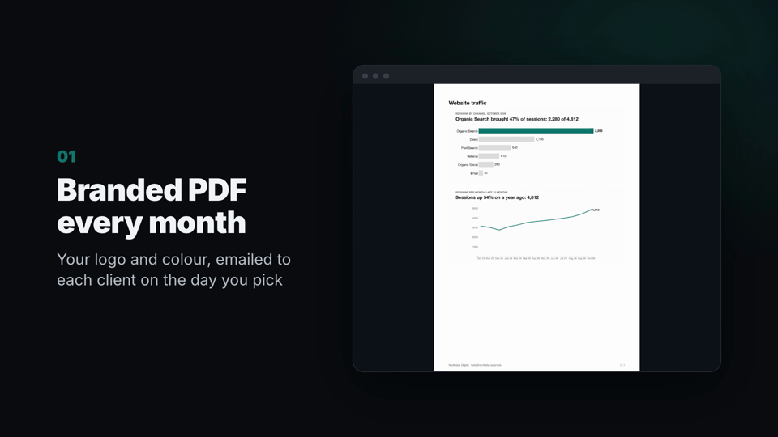
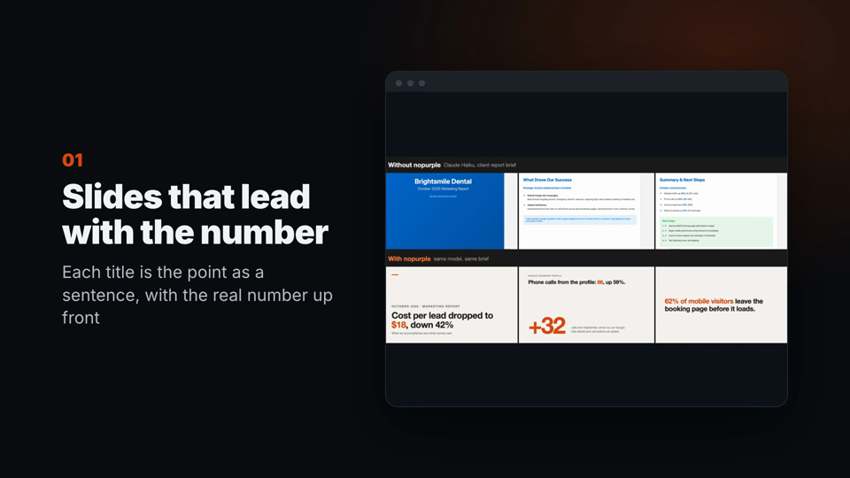
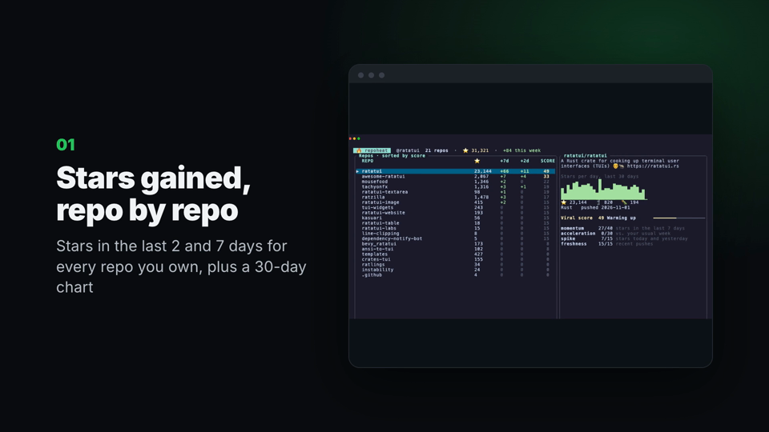
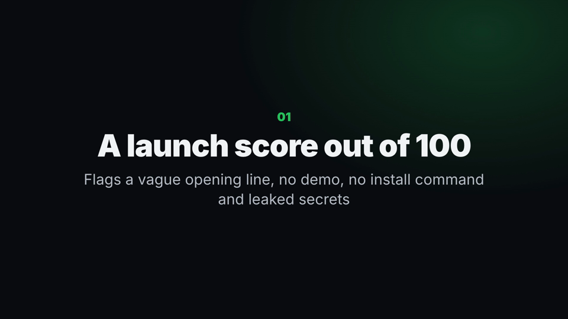

<div align="center">

# readmereel

**Turn your README into a launch video.**

[](https://github.com/taufiquebuilds/readmereel/actions/workflows/ci.yml)
[](LICENSE)


</div>

You ask your agent: "make a launch video for this repo". It reads your README, your docs and your screenshots, writes the six scenes, and shows them to you. When you say ok, it renders a wide video, a vertical video and a GIF on your machine. It is free, needs no API keys and uses no AI video model: the scenes are fixed templates, and your agent only writes the words.

This is an early release (0.1.0). It makes one video style, so expect rough edges.

## Install

```
/plugin marketplace add taufiquebuilds/readmereel
/plugin install readmereel@readmereel
```

Then: **"make a launch video for this repo"**.

For Codex, Cursor and other agents that support skills, copy `skills/readmereel` into the agent's skills folder.

## Examples

Four real repos. Each video was made from that repo's own README and screenshots.

| | |
| --- | --- |
| [](https://github.com/taufiquebuilds/agencyrecap) | [](https://github.com/taufiquebuilds/nopurple) |
| [](https://github.com/taufiquebuilds/repoheat) | [](https://github.com/taufiquebuilds/launchday) |

Each folder in [`examples/`](examples) has the `story.json` and the screenshots the video was made from, plus the GIF. The MP4s are on the release page.

## What you get

| File | Size | Post it on |
| --- | --- | --- |
| `video-16x9.mp4` | 1920×1080 | Your README, Product Hunt, Show HN, YouTube |
| `video-9x16.mp4` | 1080×1920 | X, LinkedIn, Instagram Reels, TikTok |
| `video.gif` | 960 px wide | The top of your README |

You also get `wide/` and `tall/`, two HyperFrames projects you can open and edit.

## The six scenes

| # | Scene | Time | Shows |
| --- | --- | --- | --- |
| 1 | Hook | 3 s | The problem, in your users' words |
| 2 | Title | 3 s | Name and promise |
| 3 | Feature 1 | 4 s | Title, detail, and a real screenshot if the repo has one |
| 4 | Feature 2 | 4 s | Same |
| 5 | Feature 3 | 4 s | Same |
| 6 | Install + star | 7 s | The install command, "Star on GitHub" and the repo URL |

Every claim in the video has to be something the repo shows. If a feature has no screenshot, it gets a text card. readmereel never makes or fetches an image.

## Requirements

- Node 22 or newer
- ffmpeg
- Chrome is fetched by HyperFrames on first run

A render takes 1 to 3 minutes. If something is missing, the script says how to install it.

## Edit and re-render

Your agent writes `launch-video/story.json`. To change the words, edit it and run the same command again:

```sh
node skills/readmereel/scripts/render.mjs launch-video/story.json
```

The script checks the story first and tells you which text is too long. To change the scenes themselves, open `launch-video/wide` in HyperFrames Studio with `npx hyperframes preview`.

## How it works

`story.json` goes into a scene template. HyperFrames checks the layout (`hyperframes check`), renders the wide and vertical videos (`hyperframes render`, twice), and ffmpeg makes the GIF. Built on [HyperFrames](https://github.com/heygen-com/hyperframes) (Apache-2.0) and GSAP.

## Licence

[MIT](LICENSE). The video ends with a small "made with readmereel" line. Turn it off with `"endCard": false` in `story.json`.
