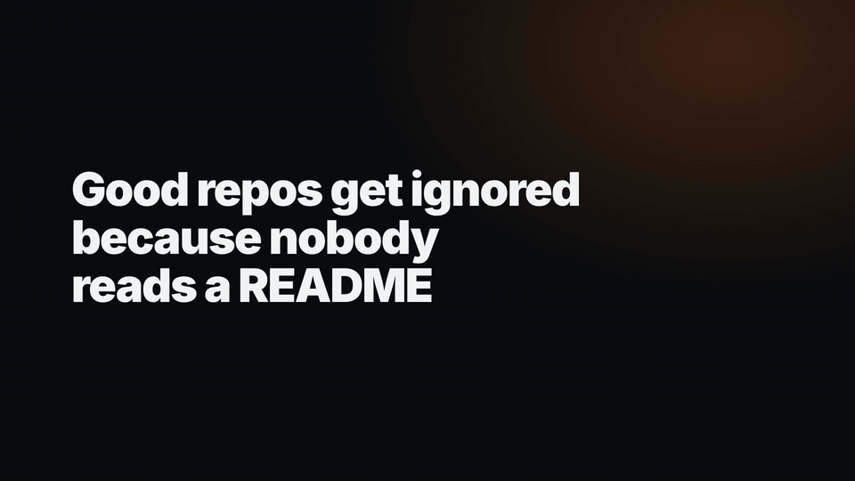
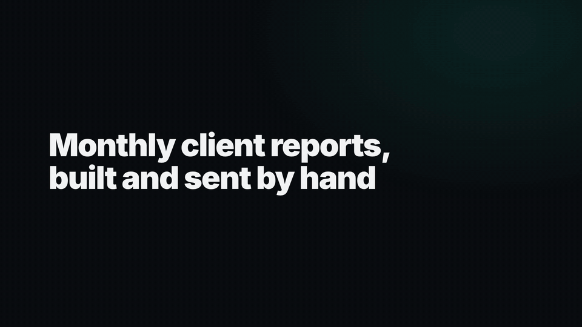
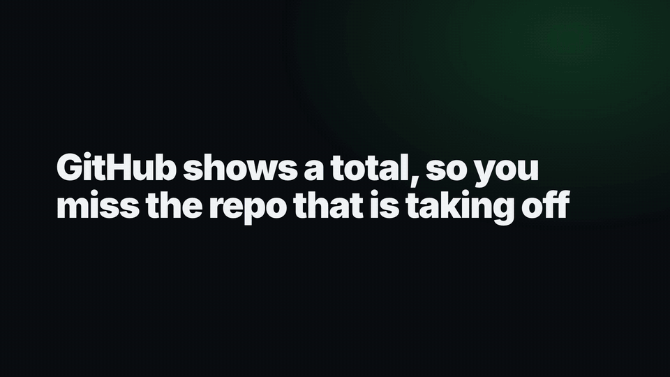
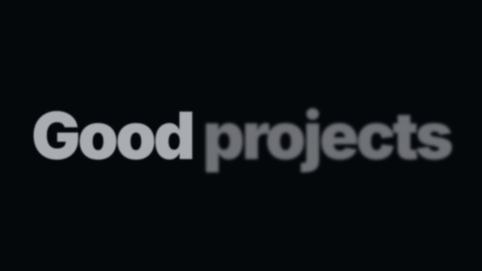

<div align="center">

# readmereel

**Turn your README into a launch film.**

[](https://github.com/taufiquebuilds/readmereel/actions/workflows/ci.yml)
[](LICENSE)



*This film was made by readmereel from this README. [Watch the MP4s](https://github.com/taufiquebuilds/readmereel/releases/latest).*

</div>

You ask your agent: "make a launch video for this repo". It reads your README, your docs and your screenshots, picks the scenes, writes the words and shows you the shot list. When you say ok, it renders a wide video, a vertical video and a GIF on your machine, then looks at the result before it hands it over. It is free, needs no API keys and uses no AI video model: the scenes are fixed templates, and your agent only writes the words and picks what to show.

## What's new in v2

v1 made one 25-second slideshow. v2 makes a 15 to 35 second film: kinetic type, the camera pushing in on your real product, transitions with a cause, and a sound on every action.

- **8 scene types.** Your agent picks 5 to 8 of them to fit your repo.
- **3 styles.** `midnight`, `paper` and `signal`, all tinted with your brand colour.
- **5 transitions.** Whip, zoom, flood, blur and carry, picked for you.
- **Sound effects.** On by default. Music is optional.
- **A strict quality gate.** Nothing renders until the layout is clean and every line is big enough to read.
- **More outputs.** A poster and a contact sheet join the two MP4s and the GIF.

### The scenes

| Scene | Shows | Good for |
| --- | --- | --- |
| `hook` | 1 to 3 big lines, optionally one number rolling up | The problem, in your users' words |
| `title` | Logo badge, name, one promise line | Who you are and the outcome |
| `ui` | Your real screenshot, or a screen rebuilt as HTML, with the camera pushing in on up to 3 spots | The product on screen; rows and labels can flip while it plays |
| `terminal` | A command typing out and its real output streaming in | CLIs and library usage |
| `counter` | Up to 3 numbers counting up | Real numbers from your repo |
| `compare` | A wipe from before to after | Without and with |
| `list` | Exactly 3 short items, one per beat | Three results |
| `end` | Logo, name, install command typed out, "Star on GitHub", URL | The call to action |

Every film starts with a `hook` and ends with an `end`. A web app usually runs `hook, title, ui, ui, counter, end`; a CLI `hook, title, terminal, terminal, list, end`; a library `hook, title, terminal, compare, counter, end`.

Every claim in the film has to be something the repo shows. Numbers come from the repo, terminal output comes from really running the command, and screenshots are your own. A rebuilt screen copies the markup and CSS of your real templates and uses demo data. readmereel never makes or fetches an image.

### Styles

| Style | Look |
| --- | --- |
| `midnight` | Dark ground, light product windows. The default |
| `paper` | Warm light ground, dark ink. For light brands |
| `signal` | Your accent colour as the ground for the hook, list and end. For loud brands |

### Sound

Sound effects (whooshes, pops, clicks, key taps and a bass hit on the end card) are on by default and can be turned off with `"sfx": false`. They are bundled by HyperFrames and resolved at render time under the Pixabay licence, so readmereel's repo contains no audio and does not redistribute any.

Music is optional and always yours: point `music` at your own mp3, m4a, wav or ogg file, or set `"music": "heygen"` to take a track from HeyGen if you are signed in to the HeyGen CLI. With neither, the film has effects only and the script tells you how to add music.

## Install

```
/plugin marketplace add taufiquebuilds/readmereel
/plugin install readmereel@readmereel
```

Then: **"make a launch video for this repo"**.

For Codex, Cursor and other agents that support skills, copy `skills/readmereel` into the agent's skills folder.

## Examples

Launch films for five real repos, each made from that repo's README, screenshots and real output. They play right here; the full-quality 16:9 and 9:16 MP4s are on the [latest release](https://github.com/taufiquebuilds/readmereel/releases/latest).

| | |
| --- | --- |
| **[readmereel](https://github.com/taufiquebuilds/readmereel)**<br> | **[agencyrecap](https://github.com/taufiquebuilds/agencyrecap)**<br> |
| **[nopurple](https://github.com/taufiquebuilds/nopurple)**<br> | **[repoheat](https://github.com/taufiquebuilds/repoheat)**<br> |
| **[launchday](https://github.com/taufiquebuilds/launchday)**<br> | |

Each folder in [`examples/`](examples) has the `story.json` the film was made from.

## What you get

| File | Size | Use it for |
| --- | --- | --- |
| `video-16x9.mp4` | 1920×1080 | Your README, Product Hunt, Show HN, YouTube |
| `video-9x16.mp4` | 1080×1920 | X, LinkedIn, Instagram Reels, TikTok |
| `video.gif` | 960 px wide | The top of your README (cut to the first 12 s if it would be over 8 MB) |
| `poster.png` | 960 px wide | A still for link previews |
| `contact.png` | | One frame per scene in both sizes. Your agent checks it before handing over |

You also get `wide/` and `tall/`, two HyperFrames projects you can open and edit (copy the folder first: it is rebuilt on every run).

## Requirements

- Node 22 or newer
- ffmpeg
- Internet access: HyperFrames comes from npm, fetches Chrome on first run, and the video loads Google Fonts and GSAP
- About 1 GB of free disk space during a render, on top of the one-time Chrome download (HyperFrames refuses to render with less than 1 GB free)
- macOS or Linux (Windows is not supported yet)

A render takes several minutes; give it a timeout of at least 15 minutes or run it in the background. If something is missing, the script says how to install it. readmereel turns HyperFrames telemetry off (`HYPERFRAMES_NO_TELEMETRY=1`).

## Edit and re-render

Your agent writes `launch-video/story.json`. To change the words, edit it and run the same command again from your repo root:

```sh
node <skill folder>/scripts/render.mjs launch-video/story.json
```

Add `--draft` for a faster, lower-quality render. `<skill folder>` is the folder that holds `SKILL.md`. For the Claude plugin it is inside the installed plugin; for other agents it is wherever you copied `skills/readmereel`. Your agent prints the exact command when it finishes.

The script checks the story first and tells you which text is too long, then runs the quality gate on both video sizes before it renders anything. `wide/` and `tall/` are rebuilt on every run, so to change the scenes themselves copy one elsewhere first, then open it in HyperFrames Studio:

```sh
cd launch-video-copy/wide && npx --yes hyperframes@0.9.9 preview
```

A `story.json` from readmereel 0.1 still works: it is converted to a v2 film and the file is not changed.

## How it works

`story.json` goes into the scene templates. A plan works out each scene's length from its text, picks the transitions and places the sound. HyperFrames checks the layout (`hyperframes check`) and renders the wide and vertical videos (`hyperframes render`, twice), and ffmpeg makes the GIF, the poster and the contact sheet. Built on [HyperFrames](https://github.com/heygen-com/hyperframes) (Apache-2.0) and GSAP.

## Licence

[MIT](LICENSE). The film ends with a small "made with readmereel" line. Turn it off with `"endCard": false` in `story.json`.
